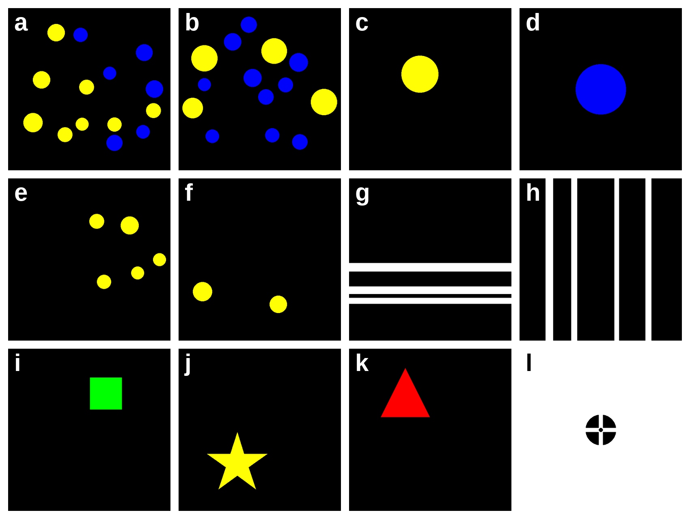

# Summary

CogStim is an open-source Python package for generating visual stimuli used in numerical cognition, psychophysics and computer vision research. It produces dot arrays for numerosity perception tasks, geometric shapes, oriented stripe patterns and fixation targets, and writes them as standard image files that any experiment software or machine-learning pipeline can load. The package is designed so that researchers can easily set every parameter of a stimulus set to meet the requirements of their study, from the number, size and colour of the elements to the conditions the set is balanced across and the correlated visual properties, such as total surface, figure placement, or convex hull. Every run records its parameters and random seed, so a set can be regenerated exactly and exported for model training. The package can be used from the command line or as a Python library.

# Statement of need

Many experiments in psychology, neuroscience and vision research need large sets of images whose visual properties are controlled: how many items each image holds, their size, position and colour. In numerosity tasks, for instance, adding dots also increases the surface they cover and the area they spread over, and participants can use those cues instead of number [@gebuis_generating_2011]. Laboratories usually write their own scripts for this. Such scripts are rarely published, the controls they apply are hard to state precisely, and their stimuli cannot be regenerated once the script is lost, which makes results hard to compare across studies and across model evaluations.

To make such stimuli easy to produce and to reproduce, we built CogStim, which generates them offline, as ordinary image files, for the paradigms our own work needed: two-colour dot arrays for the Approximate Number System (ANS) [@halberda_individual_2008], sample and match pairs for enumeration [@sella_enumeration_2013], single-colour dot arrays, and the simpler stimuli that accompany them in a test battery or a model benchmark: geometric shapes, oriented stripes [@srinivasan_vision_2021] and fixation targets [@thaler_what_2013]. Dots never overlap or leave the canvas, and the total surface of the two arrays in a pair can be left random, matched, or made to contradict the numerical ratio. Experimenters load the PNG, JPEG or SVG files into presentation software such as PsychoPy or jsPsych. Researchers who train or evaluate vision models can also request a CSV or JSON file giving the position, bounding box, size and colour of every element in every image.

# State of the field

Experiments in behavioural research are usually built with an experiment engine: PsychoPy [@peirce_psychopy2_2019] in Python, Psychtoolbox [@brainard_psychophysics_1997] in MATLAB, jsPsych [@de_leeuw_jspsych_2015] in the web browser, and PsyToolkit [@stoet_psytoolkit_2010; @stoet_psytoolkit_2017]. All of them can draw dot arrays, shapes and gratings, and they draw them while the experiment runs, inside the trial loop. That is what precise timing, adaptive procedures and gaze-contingent displays require, but it also ties each stimulus to the engine and the experiment that draws it. The images are usually drawn anew in each session, so checking them before participants see them means running the experiment or adding code to capture the screen, and the set as a whole is rarely inspected. Their construction is written in each experiment's own code, so another study or another engine cannot reuse it. And any constraint that concerns the whole set, such as presenting every ratio equally often, has to be programmed by hand in the trial logic.

We built CogStim as a separate tool, rather than as part of one of these engines, for three reasons. First, the stimuli are often needed outside any engine. Psychological and educational test batteries are increasingly run on web platforms and on tablet applications developed in house, both in laboratories and in schools [@anwyl-irvine_gorilla_2020; @bridges_timing_2020; @correig-fraga_development_2024], and the same kind of stimuli is used to train and evaluate neural networks [@testolin_visual_2020; @nasr_number_2019]. Exporting thousands of images from an engine means running its window system without a screen, whereas our package directly writes the files. Second, a stimulus set should be checked before anyone sees it. Many designs need every image to be correct and the set as a whole to be balanced: dots that never overlap or leave the canvas, two arrays whose total surface is matched when the design requires it, and every count and ratio represented equally often. Because our package builds the whole set before the experiment and writes it to disk, these constraints are verified while the set is built, anything that could not be produced is reported, and the researcher can inspect every image, or analyse the set as a whole, before the first participant sees it. Third, a stimulus set should be part of the research record. Every run writes its options and random seed next to the images, so the same set can be regenerated, inspected and reused by other studies whatever software they present it with, as reproducible research requires.

A second group of tools generates numerosity stimuli specifically: the program of Gebuis and Reynvoet [@gebuis_generating_2011], CUSTOM [@de_marco_introducing_2020], NASCO [@guillaume_nasco_2020] and GeNEsIS [@zanon_towards_2022]. They control the continuous visual properties of dot arrays in detail and are the closest relatives of our dot tasks, but all four are written in MATLAB, so running or modifying them requires a commercial licence. By contrast, CogStim is a Python package: it is open source and runs on any computer with a free Python installation, which makes it available to any laboratory, school or student regardless of the software they can pay for. It also records each run so that it can be regenerated, exports the position of every element for model training, and produces the other stimuli of a battery, such as shapes, stripes and fixation targets, alongside the dot arrays.

# Software design

The software architecture prioritizes modularity and simplicity so that adding a stimulus type and changing stimuli details is safe and easy. A base generator class does everything common to all tasks: it builds the list of images a run will produce, creates the output directories, sets the random seed, saves each image in the requested format and records what was drawn. Each stimulus type is a subclass that only decides what a set contains and how one image is drawn, decoupling the new stimulus creation from the inner workings of the package.

Users choose a stimulus set through options, which we designed so that one set of rules covers every task. Each option is declared once and shared by every task that uses it. Names follow an easy-to-understand pattern, with the unit in the name (`--min-dot-radius-px`) and colours numbered (`--dot-colour-1`), and every default is shown in the help. Before generating anything, each run builds the list of images it will produce: `--dry-run` prints how many there will be, and the message at the end of a run reports how many were actually written. Each option is declared in a registry, so that it cannot fall out of step with the program.

For reporting and reproducibility, each run writes its options and seed to a `cogstim_config.yaml` file beside the images, and `cogstim run` takes that file as input. The file is both the record of a set and the way to produce it again: researchers who prefer configuration files can write one directly, and those who prefer the command line still end up with one.

The package needs only Python 3.10 or later [@python], Pillow [@clark2015pillow] for drawing, NumPy [@harris2020array] for geometry, tqdm [@tqdm] for progress bars and PyYAML for configuration files. All of them install with `pip`, and none needs a display, so it runs unchanged on a laptop, a server or a batch job. We chose this over building on the drawing layer of an experiment engine, accepting that it cannot present stimuli or record responses.

# Research impact statement

Innovamat Education uses CogStim to generate the dot-array stimuli of COSMOS, a cognitive and numerical screening test that it administers twice every school year to about 50,000 children in the first two years of primary school. These stimuli were used in a published study of a response-to-intervention framework in mathematics [@correig-fraga_development_2024]. The package also produced the synthetic image datasets of a study of visual computation in the Drosophila visual system [@correig-fraga_structure_2026].

The code is released under the MIT licence, so any laboratory, school or company can use it, modify it and redistribute it, including inside their own applications. It is also built to be adapted to each researcher's needs. Adding a stimulus type means writing one class that states what a set contains and how one image is drawn; file handling, seeding, image counts and the exports come from the base class, and the developer documentation works through a complete example. The same design serves the reproducibility that journals increasingly ask for [@nosek_promoting_2015]. A study can share the configuration file of its stimuli rather than the images or the script that made them, and anyone can regenerate exactly the same set, inspect it, or change one parameter and generate a variant.

# Example figures

**Figure 1.** Example stimuli. **(a, b)**  Two-colour dot arrays for ANS tasks, with dot sizes drawn independently (a) or with the same total surface for both colours (b). **(c, d, i-k)** Geometric shapes. **(e, f)**  Single-colour dot arrays, as used in match-to-sample tasks. **(g, h)** Oriented stripes. **(l)** Fixation target.

# Availability

- Repository: https://github.com/eudald-seeslab/cogstim
- License: MIT
- Issue tracker: enabled and publicly readable
- Archive: upon acceptance, we will create a tagged release, archive on Zenodo and include the DOI here.

# Acknowledgements

We thank Innovamat Education for their support in the development of this open source work.

# AI usage disclosure

The core architecture and foundational algorithms were developed prior to the widespread adoption of generative AI. However, during recent development cycles, AI assistants were utilized to assist in refactoring, homogenizing interfaces, and expanding specific functionalities. Cursor's Composer 2 was used in 2025 for code completion and refactoring; Claude Opus 5 (August 2026) and Claude Fable 5.1 (October 2026) for code, tests and documentation; and Claude Fable 5.1 and Claude Opus 5.5 for drafting revised sections of this paper. The author made the design decisions, reviewed, edited and tested all AI-generated content, and takes full responsibility for the software and the paper.

# Conflicts of Interest

The author is employed by Innovamat Education, which uses CogStim in its assessments.

# References
